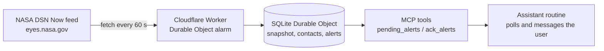

# DSN Lifeline

DSN Lifeline watches NASA's Deep Space Network through the public DSN Now feed and queues an alert when one of your favourite spacecraft starts talking to Earth. It runs as a Cloudflare Worker with one SQLite Durable Object, and it exposes the queue as a pull-based MCP server. An AI assistant routine calls `pending_alerts` on a schedule, tells you about anything new, and calls `ack_alerts` when done. The server never pushes anything to a phone or any other outside host.

## Architecture



`src/index.js` checks the key and the body size, then hands `POST /mcp` to one Durable Object named `main`. `src/lifeline.js` is a thin shell over the alert queue, the contact tracker, and the saved state. An alarm runs every 60 seconds, fetches at most one feed, and fetches the config at most once per 24 hours. The alarm is re-armed in `finally`.

A craft counts as talking when an active downlink matches its table `spacecraftID` on two accepted snapshots in a row. A contact closes after three missed accepted snapshots and reopens if the gap is 14 good polls or fewer. Rejected polls do not count as absence.

## Tools

| Tool | Arguments | Purpose |
|---|---|---|
| `dsn_now` | `watched_only` (boolean, required) | Which watched crafts are talking, and on which dish and station |
| `watchlist` | none | Current watchlist |
| `watch_craft` | `code`, `favourite` (boolean) | Add a craft, optionally as a favourite that raises alerts |
| `unwatch_craft` | `code` | Remove a craft |
| `mute_craft` | `code`, `hours` (integer 0 to 720; 0 clears the mute) | Silence a craft for a while |
| `source_status` | none | Feed freshness, coverage, backoff, and row budget |
| `pending_alerts` | none | Unacknowledged alerts still inside their 20 minute window |
| `ack_alerts` | `ids` (array of strings) | Mark alerts done after the user was told |
| `test_alert` | none | Queue one fixed test alert, not counted as a favourite |

`pending_alerts` returns `id`, `kind`, `craft`, `dish`, `station`, and `time` for each alert. The same array is the text of the tool result, as JSON, so a client can ack without reading the structured block. Kinds are `fav`, `stale`, `canary`, `shape`, and `test`. `ack_alerts` ignores ids that are missing or already finished, and an empty `ids` list returns `INVALID_INPUT`. Codes are 2 to 12 characters, lowercase letters and digits. Unknown fields return `INVALID_INPUT`.

Watched crafts are chosen from a local table in `src/crafts.js`: Europa Clipper (`eurc`), Psyche (`psyc`), IMAP (`imap`), and SWFO-L1 (`swfo`).

## Setup

Requires Node 22.

1. Install and test:
   ```
   npm ci
   npm test
   npm run typecheck
   ```
2. Local run: copy `.dev.vars.example` to `.dev.vars`, set `API_KEY` to a random string of at least 20 characters, then `npm run dev`. `.dev.vars` is gitignored.
3. Deploy with Wrangler:
   ```
   npx wrangler login
   npx wrangler secret put API_KEY
   npx wrangler deploy
   ```
4. Set `DEFAULT_TZ` (an IANA zone such as `America/Toronto`, which is also the default) as a plain variable in the Cloudflare dashboard. `wrangler.toml` sets `keep_vars = true` so it survives deploys.
5. Point an MCP client at `https://dsn-lifeline.<your-subdomain>.workers.dev/mcp` with header `Authorization: Bearer <API_KEY>` or `X-API-Key: <API_KEY>`.

`GET /health` returns `{"ok":true,"spec_version":2}` and does not call the Durable Object.

## Assistant routine

Run this prompt as a routine every 5 minutes in an assistant that supports MCP tools:

```
Every 5 minutes, call the DSN Lifeline tool pending_alerts.
Read the text of the result. It is a JSON array. Each item has id, kind, craft, dish, station, and time.
If the array is empty, stay quiet.
For each alert, send the user one chat message:
- kind fav, when dish and station are both present: "<craft> is talking at <time> on dish <dish> at <station>."
- kind fav, when dish or station is missing: "<craft> is talking at <time>."
- kind stale: "DSN Lifeline: no fresh snapshot for 6 hours."
- kind shape: "DSN Lifeline: the feed shape looks wrong."
- kind canary: "DSN Lifeline: no spacecraft talking seen in 24h. Check the matcher."
- kind test: "DSN Lifeline: test alert at <time>."
Then call ack_alerts with the ids from that JSON.
```

Example: asking "Is Europa Clipper talking?" calls `dsn_now` and yields something like `Europa Clipper, dish DSS14, complex Goldstone, talking yes, snapshot age 42 seconds.` When a favourite craft talks for the first time in a local day, `pending_alerts` returns one `fav` row with the craft, dish, station, and local time.

## Safety

The feed is untrusted XML. The server never copies feed names, debug strings, or target names into an alert, a log line, or a tool result.

- **The key is required.** `API_KEY` must be at least 20 characters. A missing, short, or wrong key returns 401 and does not reveal whether the server is configured. That path never touches the Durable Object. A valid key with a timezone the server cannot use returns `NOT_CONFIGURED`.
- **Chat lines are a fixed template.** The routine uses the craft name from the local table, a dish matching `DSS` plus two digits, a station of Goldstone, Canberra, or Madrid, and a local time. Those lines match `^[A-Za-z0-9 .,:()'-]{1,140}$`. When dish or station is missing, the routine omits that part.
- **Outbound hosts are fixed.** Only `eyes.nasa.gov`. There is no feed base URL override and no notification host.
- **Auth runs first.** The key check and the 16,384 byte body cap both happen before any Durable Object call.

## Design decisions

**Free-tier row budget.** Durable Object SQLite on the free plan allows 100,000 row writes per day. A quiet day here costs about two writes a minute (the alarm plus one snapshot), around 2,880 rows, so roughly 3k writes a day. At 70,000 rows today the poll interval becomes 120 seconds until UTC midnight. At 80,000 the server latches a budget flag for that UTC day and stops queueing chat alerts. `source_status` reports the counter. Pending alerts are capped at 100 and the oldest is dropped to make room.

**100-parameter batching.** Durable Object SQLite limits a statement to 100 bound parameters. `ack_alerts` updates ids in batches of 100, so a long id list cannot fail on the cap.

**Constant-time auth.** Both the presented key and the expected key are hashed with SHA-256 and the digests are compared with `timingSafeEqual`. Hashing first gives equal-length inputs, so neither the length nor the content of the key leaks through timing.

**Size caps.** Request bodies over 16,384 bytes are rejected, using `Content-Length` when present and a capped stream read when it is absent. A malformed `Content-Length` is rejected before any buffering. Feed bodies over 256 KB are rejected.

**Pull, not push.** A push path needs an outbound notification host, a stored topic or token, and delivery retries. Pull keeps the server's only outbound host as NASA, leaves no push credential to leak, and lets the assistant decide how and when to tell the user. The cost is latency of up to one routine interval. Each alert stays relevant for 20 minutes, so a 5 minute routine has several chances to see it.

## Testing

`npm test` runs Node's built-in test runner. Tests use a fake clock, a fake fetch, and `node:sqlite`, so they never call NASA. `node scripts/write-fixtures.js` rewrites the XML fixtures.

Last run on Node 22 (v22.23.3): 121 tests across 20 test files, 121 pass, 0 fail, 0 skipped (120 existing plus the new version test). `npm run typecheck` (TypeScript strict with `checkJs`) reports no errors. CI runs both on every push (`.github/workflows/ci.yml`).

## How it was built

The spec was locked before coding. Behaviour was written test first, and each change then went through an independent review loop in which a reviewer who had only the spec and the diff looked for faults, and findings were fixed and re-checked. The 1.0.1 version fix followed the same rule: a failing test asserting that `serverInfo.version` equals the `package.json` version was written before the bump.

## Limitations

- Only Psyche (`psyc`, -255) has been seen on the live feed. The IDs for Europa Clipper (-159), IMAP (-43), and SWFO-L1 (-231) are not live-verified, so those alerts may never fire until the IDs are checked.
- Step 0 gate result, from one recorded run of `gates/step0`: 60 of 60 polls succeeded, and Psyche was talking in 24 of the 60. The gate is a throwaway Worker. Do not deploy it, because a run polls NASA.
- There is no push of any kind. Alerts only reach you if a routine polls the queue.
- The feed has no documented stability guarantee. The server checks the shape and queues a `shape` alert when it looks wrong.
- Tests do not run inside the real Workers runtime. `test/workerd-shape.test.js` only checks the export shape.

## Limits

Watchlist max 12. Favourite alerts: 1 per craft per local day, 6 created per local day, including dropped rows and one retry if that alert expires while the contact is still talking and the cap still has room. System alerts (stale, canary, and shape, counted by the local day they were created): 10 created per local day, including dropped rows, and one retry while the condition still holds. Pending queue: 100. Each alert is relevant for 20 minutes. Rows older than 2 days are deleted once each UTC day. Deleting them does not queue that stale or canary alert again. At local midnight the local day changes, a craft can raise one favourite again on the new local day, and the daily caps reset. An alert queued before local midnight stays until it is acknowledged or its 20 minute window ends. The caps do not reset at UTC midnight, which is only the row-budget day. Muting or unwatching a craft drops its pending favourite alerts. `watch_craft` changes: 10 per local day. `mute_craft` and `unwatch_craft`: 30 calls per local day each. `test_alert`: 3 per hour. All tools: 60 calls per UTC hour.

## Credits

Spacecraft contact data comes from NASA/JPL's [DSN Now](https://eyes.nasa.gov/dsn/dsn.html) feed. This project is not affiliated with or endorsed by NASA or JPL. Check their terms of use before running it against the feed, and keep the polling rate modest.

## License

MIT. See `LICENSE`.
